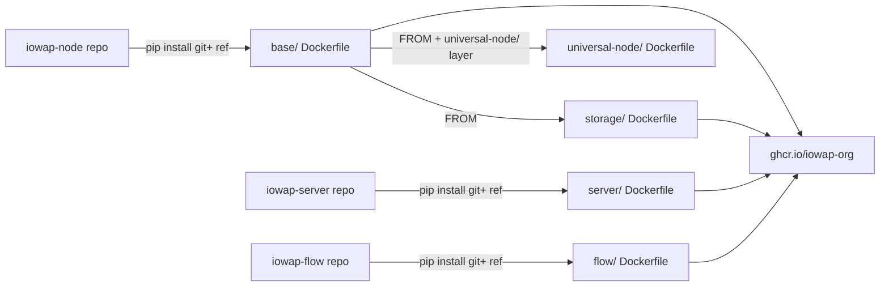

# IOWAP Docker

Central repository for all IOWAP Docker images. Each subdirectory builds one
image; the build context is always the repo root, so `COPY` paths mirror the
directory structure.

[IOWAP](https://github.com/iowap-org) (Inter-Node Offload · Workload
Advertisement · Protocol) is a self-hosted task fleet: a relay server assigns work
to registered nodes over their capabilities.

## Images

| Image            | Directory  | Base               | Published as                                        |
| ---------------- | ---------- | ------------------ | --------------------------------------------------- |
| `iowap-node-base` | `base/`    | `python:3.11-slim` | [ghcr.io/iowap-org/iowap-node-base](https://github.com/iowap-org/iowap-docker/pkgs/container/iowap-node-base) |
| `iowap-storage`  | `storage/` | `iowap-node-base`  | [ghcr.io/iowap-org/iowap-storage](https://github.com/iowap-org/iowap-docker/pkgs/container/iowap-storage) |
| `iowap-universal-node` | `universal-node/` | `iowap-node-base` + `iowap-node-mcp` wheel (T-037) | [ghcr.io/iowap-org/iowap-universal-node](https://github.com/iowap-org/iowap-docker/pkgs/container/iowap-universal-node) |
| `iowap-server`   | `server/`  | `python:3.11-slim` | [ghcr.io/iowap-org/iowap-server](https://github.com/iowap-org/iowap-docker/pkgs/container/iowap-server) |
| `iowap-flow`     | `flow/`    | `python:3.11-slim` | [ghcr.io/iowap-org/iowap-flow](https://github.com/iowap-org/iowap-docker/pkgs/container/iowap-flow) |

Build chain — nodes install the `iowap-node` package from GitHub at build
time, so service images are rebuilt (not restarted) whenever the pin moves:



All images are public; `:latest` tracks the last successful CI build.

## Quick start

### Relay server

```bash
docker run -d --name iowap-server -p 8788:8788 \
  -e RELAY_MASTER_SEED=<your-seed> \
  ghcr.io/iowap-org/iowap-server:latest
```

Or build and run locally:

```bash
docker compose -f server/docker-compose.yml up -d
```

Pin `RELAY_MASTER_SEED` in a `.env` so the admin seed survives rebuilds.
Default is SQLite (persisted in the `relay-data` volume); for PostgreSQL use
`--profile postgres` with `RELAY_DB_TYPE=postgres` + `RELAY_PG_DSN`.

### Storage node

```bash
docker compose -f storage/docker-compose.yml up -d
# or with an external relay and your NAS path:
RELAY_URL=http://<relay-host>:8788 STORAGE_DIR=/mnt/nas/storage \
  docker compose -f storage/docker-compose.yml up -d
```

`RELAY_URL` is required. The node registers as `pending`; approve it on the
relay dashboard. State (identity, tokens) lives in the `storage-state` volume
mounted at `/home/appuser/.relay` — keep it, or the node re-registers on every
restart.

> **Updating nodes:** the wheel is baked into the image layer — restart is not
> an update. Pull a new image and recreate the container (state volume
> untouched); identity is preserved, no re-approval needed.

### Universal node

`universal-node/docker-compose.yml` runs the universal-node **flavour** image
(ghcr.io/iowap-org/iowap-universal-node — iowap-node-base plus the
container-HTTP MCP layer built from the iowap-node-mcp wheel, T-037) as a
self-contained **universal node**: it starts blank (idle, no relay
traffic) and gains two optional integrations — a bridge to host-side
capability providers and an HTTP MCP endpoint for agents on the same host.

Manual use (without any daemon):

```bash
# Defaults: workspace under ./universal-node-workspace, MCP on 127.0.0.1:7781
docker compose -f universal-node/docker-compose.yml up -d

# Or point the workspace at your own host directory:
IOWAP_WORKSPACE_DIR=/srv/iowap/workspace \
  docker compose -f universal-node/docker-compose.yml up -d
```

The container starts idle until it is registered against a relay (e.g. via
`docker exec iowap-universal-node iowap-cli node register <relay-host> --name <name>`).
Registration state and `node.yaml` live in the `universal-node-state` volume
(mounted at `/home/appuser/.relay`), so the node survives restarts without
re-registering.

The bridge/MCP tokens are **optional** — the node runs fine without them.
In the managed flow, the bridge daemon creates the container and injects both
tokens as environment variables at bootstrap; this file only defines the
interface so the daemon does not have to invent it. The MCP endpoint is
published on `127.0.0.1:7781` (loopback-only on purpose: reachable from
agents on the same host, never from the network) and requires the MCP bearer
once set.

How the daemon uses it: the bridge daemon does not build containers itself —
it executes exactly this profile through the Docker Engine API (same image,
same port mappings, same volumes) and injects the two tokens at container
creation. Think of this file as the blueprint for that flow.

| Variable | Default | Purpose |
| -------- | ------- | ------- |
| `IOWAP_BRIDGE_TOKEN` | *(unset)* | Optional. Bearer token the node presents to the bridge daemon's manifest/exec endpoints (`bridge.token` in `node.yaml`). Injected by the bridge daemon at bootstrap; blank start works without it. |
| `IOWAP_MCP_BEARER` | *(unset)* | Optional. Bearer token agents must present when calling the node's HTTP MCP endpoint. Injected by the bridge daemon at bootstrap; blank start works without it. |
| `IOWAP_WORKSPACE_DIR` | `./universal-node-workspace` | Host directory shared with the bridge daemon for artifact exchange (mounted at `/workspace` in the container). Use the same root the daemon uses. |

On Linux hosts, `host.docker.internal` is mapped to the host gateway via
`extra_hosts` (the bridge URL configured in `node.yaml` relies on it). Docker
Desktop (Windows/macOS) provides this mapping natively; the entry is harmless
there.

### Processes in the universal-node container

The universal-node entrypoint (a 1:1 derivative of the base entrypoint with
the MCP surface swapped, T-037) manages up to two processes:

| Process | Port | Purpose |
| ------- | ---- | ------- |
| `iowap-daemon` (PID 1 child, `exec`'d) | `7783` (loopback) | Node UI + status, SSE/HTTP connection to the relay, heartbeat |
| `iowap-node-mcp --http` (background, supervisor) | `7781` (loopback) | HTTP MCP endpoint for agents on the same host — **only started when `IOWAP_MCP_BEARER` is set**; otherwise the entrypoint logs `MCP disabled (no bearer)` and port 7781 stays closed. Serves Streamable HTTP at `/mcp` with the bearer as static auth (fail closed). |

The MCP server's PID is written to `~/.relay/mcp.pid` so the node dashboard
can later enable/disable it (T-021). Both processes log to the container's
stdout/stderr. `iowap-node-mcp` (>= 0.1.0, PyPI) provides the
`iowap-node-mcp` entry point and pulls `iowap-client-mcp` (>= 0.2.0) as its
toolset dependency (T-037 split); the HTTP transport binds `0.0.0.0` inside
the container because the published port reaches the container's eth0 — the
host-side publish (`127.0.0.1:7781`) keeps it loopback-only from outside.

## Build args

Every image pins its source repo via a build arg — a git tag, branch or
commit SHA, default `main`:

| Build arg          | Image             | Typical pin                          |
| ------------------ | ----------------- | ------------------------------------ |
| `IOWAP_NODE_REF`   | `base/`, `storage/` | `wheel-v2.3.18` (release tag)      |
| `IOWAP_SERVER_REF` | `server/`         | commit SHA (the repo has no tags)    |
| `IOWAP_FLOW_REF`   | `flow/`           | branch or tag name                   |

```bash
docker build -t iowap-node-base --build-arg IOWAP_NODE_REF=wheel-v2.3.18 -f base/Dockerfile .
```

## CI

| Workflow               | Trigger                                          | What it does |
| ---------------------- | ------------------------------------------------ | ------------ |
| `build-images.yml`     | push to `main`, `workflow_dispatch`, `repository_dispatch: rebuild-images` | Builds and pushes all images (`:latest` + ref tags), exports digests |
| `refresh-node-base.yml` | schedule (30 min)                               | Polls iowap-node releases and dispatches `build-images.yml` when a new wheel release appeared |
| `sync-docs.yml`        | `workflow_run` after a green build               | Syncs current image refs into the [iowap-docs](https://github.com/iowap-org/iowap-docs) repo |

Dispatch a build with specific refs:

```bash
gh api repos/iowap-org/iowap-docker/dispatches \
  -f event_type=rebuild-images \
  -f "client_payload[iowap_node_ref]=wheel-vX.Y.Z" \
  -f "client_payload[iowap_flow_ref]=main"
```

Note: merges in the source repos do **not** trigger builds by themselves —
the release poll covers wheel releases; anything else needs the dispatch
above.

## Source repositories

- [iowap-server](https://github.com/iowap-org/iowap-server) — relay server code
- [iowap-node](https://github.com/iowap-org/iowap-node) — node framework (daemon, CLI, handler runner)
- [iowap-storage](https://github.com/iowap-org/iowap-storage) — storage node handlers
- [iowap-flow](https://github.com/iowap-org/iowap-flow) — flow runner (plan/fan-out/join orchestrator node)
- [iowap-docs](https://github.com/iowap-org/iowap-docs) — full documentation

## License

MIT — see [LICENSE](LICENSE).