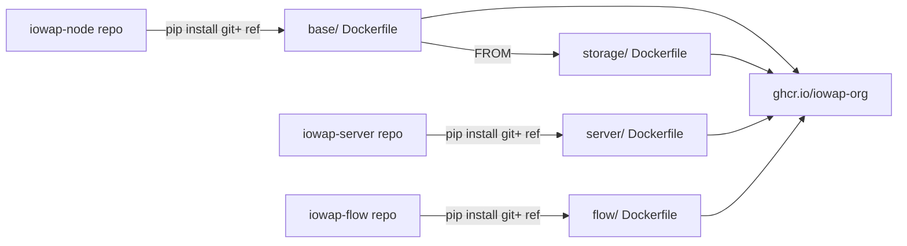

# IOWAP Docker

Central repository for all IOWAP Docker images. Each subdirectory builds one
image; the build context is always the repo root, so `COPY` paths mirror the
directory structure.

[IOWAP](https://github.com/iowap-org) (Infrastructure · Offloading · Workload
Assignment Platform) is a self-hosted task fleet: a relay server assigns work
to registered nodes over their capabilities.

## Images

| Image            | Directory  | Base               | Published as                                        |
| ---------------- | ---------- | ------------------ | --------------------------------------------------- |
| `iowap-node-base` | `base/`    | `python:3.11-slim` | [ghcr.io/iowap-org/iowap-node-base](https://github.com/iowap-org/iowap-docker/pkgs/container/iowap-node-base) |
| `iowap-storage`  | `storage/` | `iowap-node-base`  | [ghcr.io/iowap-org/iowap-storage](https://github.com/iowap-org/iowap-docker/pkgs/container/iowap-storage) |
| `iowap-server`   | `server/`  | `python:3.11-slim` | [ghcr.io/iowap-org/iowap-server](https://github.com/iowap-org/iowap-docker/pkgs/container/iowap-server) |
| `iowap-flow`     | `flow/`    | `python:3.11-slim` | [ghcr.io/iowap-org/iowap-flow](https://github.com/iowap-org/iowap-docker/pkgs/container/iowap-flow) |

Build chain — nodes install the `iowap-node` package from GitHub at build
time, so service images are rebuilt (not restarted) whenever the pin moves:



All images are public; `:latest` tracks the last successful CI build.

## Quick start

### Relay server

```bash
docker run -d --name iowap-server -p 8788:8788 \
  -e RELAY_MASTER_SEED=<your-seed> \
  ghcr.io/iowap-org/iowap-server:latest
```

Or build and run locally:

```bash
docker compose -f server/docker-compose.yml up -d
```

Pin `RELAY_MASTER_SEED` in a `.env` so the admin seed survives rebuilds.
Default is SQLite (persisted in the `relay-data` volume); for PostgreSQL use
`--profile postgres` with `RELAY_DB_TYPE=postgres` + `RELAY_PG_DSN`.

### Storage node

```bash
docker compose -f storage/docker-compose.yml up -d
# or with an external relay and your NAS path:
RELAY_URL=http://<relay-host>:8788 STORAGE_DIR=/mnt/nas/storage \
  docker compose -f storage/docker-compose.yml up -d
```

`RELAY_URL` is required. The node registers as `pending`; approve it on the
relay dashboard. State (identity, tokens) lives in the `storage-state` volume
mounted at `/home/appuser/.relay` — keep it, or the node re-registers on every
restart.

> **Updating nodes:** the wheel is baked into the image layer — restart is not
> an update. Pull a new image and recreate the container (state volume
> untouched); identity is preserved, no re-approval needed.

## Build args

Every image pins its source repo via a build arg — a git tag, branch or
commit SHA, default `main`:

| Build arg          | Image             | Typical pin                          |
| ------------------ | ----------------- | ------------------------------------ |
| `IOWAP_NODE_REF`   | `base/`, `storage/` | `wheel-v2.3.18` (release tag)      |
| `IOWAP_SERVER_REF` | `server/`         | commit SHA (the repo has no tags)    |
| `IOWAP_FLOW_REF`   | `flow/`           | branch or tag name                   |

```bash
docker build -t iowap-node-base --build-arg IOWAP_NODE_REF=wheel-v2.3.18 -f base/Dockerfile .
```

## CI

| Workflow               | Trigger                                          | What it does |
| ---------------------- | ------------------------------------------------ | ------------ |
| `build-images.yml`     | push to `main`, `workflow_dispatch`, `repository_dispatch: rebuild-images` | Builds and pushes all images (`:latest` + ref tags), exports digests |
| `refresh-node-base.yml` | schedule (30 min)                               | Polls iowap-node releases and dispatches `build-images.yml` when a new wheel release appeared |
| `sync-docs.yml`        | `workflow_run` after a green build               | Syncs current image refs into the [iowap-docs](https://github.com/iowap-org/iowap-docs) repo |

Dispatch a build with specific refs:

```bash
gh api repos/iowap-org/iowap-docker/dispatches \
  -f event_type=rebuild-images \
  -f "client_payload[iowap_node_ref]=wheel-vX.Y.Z" \
  -f "client_payload[iowap_flow_ref]=main"
```

Note: merges in the source repos do **not** trigger builds by themselves —
the release poll covers wheel releases; anything else needs the dispatch
above.

## Source repositories

- [iowap-server](https://github.com/iowap-org/iowap-server) — relay server code
- [iowap-node](https://github.com/iowap-org/iowap-node) — node framework (daemon, CLI, handler runner)
- [iowap-storage](https://github.com/iowap-org/iowap-storage) — storage node handlers
- [iowap-flow](https://github.com/iowap-org/iowap-flow) — flow runner (plan/fan-out/join orchestrator node)
- [iowap-docs](https://github.com/iowap-org/iowap-docs) — full documentation

## License

MIT — see [LICENSE](LICENSE).